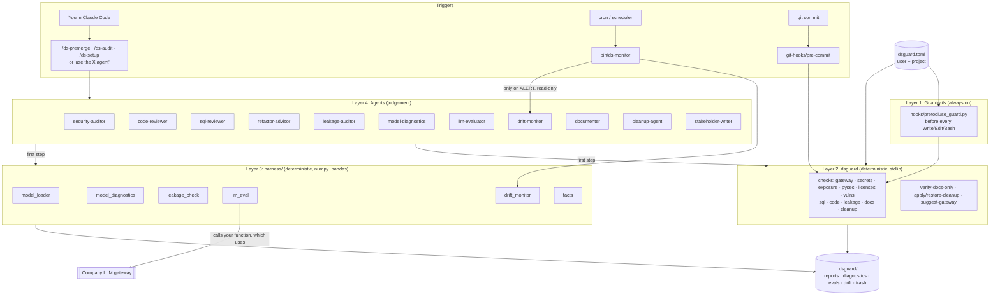
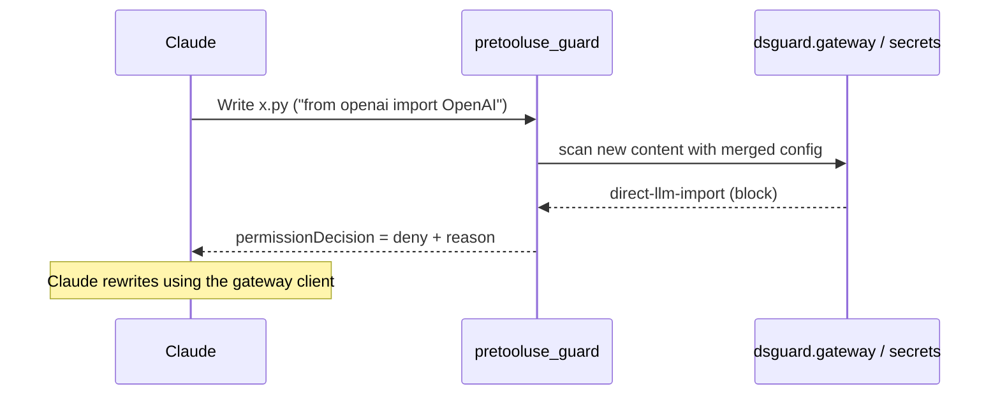
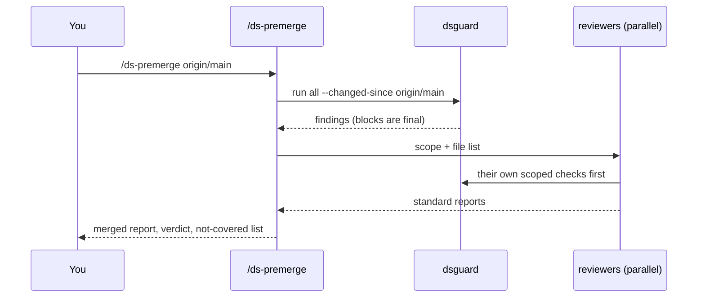

# Architecture

How the DS agent toolkit is put together, why it is shaped this way, and how to extend it.
For what it does and how to use it, see [README.md](README.md).

## 1. Purpose

A personal automation layer for a data-science lead who works on tabular, text and LLM
projects. It runs in Claude Code on the lead's own machine and covers six jobs:

| Job | Examples |
|---|---|
| **Guard** | Nothing bypasses the LLM gateway, no secrets or customer data leak, no license surprises |
| **Review** | Code, SQL, leakage, refactoring opportunities, before merge or on demand |
| **Analyze** | Model diagnostics, data leakage checks, LLM evaluations |
| **Monitor** | Scheduled drift checks on deployed models |
| **Communicate** | Stakeholder summaries whose numbers are machine-verified |
| **Maintain** | Documentation and repository cleanup, done safely |

## 2. Design principles

1. **Deterministic first.** If a regex, AST walk, metric or metadata lookup can decide something,
   a script decides it. Scripts give the same answer every run, can gate a commit, and can't be
   persuaded. Agents (LLM reasoning) handle only what needs judgement.
2. **Agents run the script before they reason.** Every agent's first step is a `dsguard` or
   `harness/` command. Agents can't overrule a `block`, and every report has a
   "Not covered" section.
3. **Skipped is never passed.** A missing external tool (gitleaks, pip-audit, sqlfluff, bandit)
   is reported as skipped or not covered, never as clean.
4. **Least privilege by default.** Four of the eleven agents are strictly read-only. The rest
   write only to docs, `.dsguard/` scratch and reports, eval files or monitoring config, never to
   pipeline or model code. Where they write, their output is verified (documenter →
   `verify-docs-only`, stakeholder-writer → `facts.py verify`, cleanup → your approval and a
   reversible apply).
5. **Reversible actions.** Cleanup moves files to a timestamped trash, with a restore command.
   Nothing is deleted outright, and the hook asks before any `rm -r`.
6. **Nothing company-specific is hardcoded.** Gateway hosts, SQL tables and license policy live
   in config, filled in on the work machine by `/ds-setup`.
7. **Few dependencies.** `dsguard`, the hooks, `llm_eval.py` and `facts.py` need only the Python
   3.11+ standard library. The data scripts need only numpy and pandas; sklearn, LightGBM,
   XGBoost, PyTorch, matplotlib and pyarrow are optional.

## 3. System overview



The same picture as text:

```
 Triggers            Layer 1 guardrails        Layer 4 agents            Layers 2-3 deterministic
 ─────────           ──────────────────        ──────────────            ────────────────────────
 Claude edit/run ──▶ PreToolUse hook ────────────────────────────────▶  dsguard gateway+secrets
 git commit      ──▶ pre-commit ─────────────────────────────────────▶  dsguard run commit
 /ds-premerge    ──────────────────────────▶  reviewers (parallel) ──▶  dsguard run all --changed-since
 /ds-audit       ──────────────────────────▶  all reviewers         ──▶  dsguard + harness
 "use agent X"   ──────────────────────────▶  any agent             ──▶  its script first
 cron            ──▶ bin/ds-monitor ─────────────────────────────────▶  harness/drift_monitor
                        └─ on ALERT ───────▶  drift-monitor (read-only)
                                                       │
                                     results ──▶ .dsguard/ (git-ignored) ◀── scripts write JSON + MD
```

## 4. Components

### Layer 1: Guardrails

| Component | Trigger | Decision |
|---|---|---|
| `hooks/pretooluse_guard.py` | Claude Code `PreToolUse` on `Write\|Edit\|MultiEdit\|NotebookEdit\|Bash` | **deny**: new content imports a provider SDK, references a provider host, or contains a high-confidence secret; a Bash command calls a provider host. **ask**: recursive `rm`. Otherwise silent. |
| `git-hooks/pre-commit` | `git commit` | `dsguard run commit --staged`: gateway and secrets on staged files; a block fails the commit |

The hook **fails open**: an internal error lets the edit through, with a message on stderr. A
broken hook must not stop work. The pre-commit hook and `/ds-premerge` run the same rules as
the backstop. Both use the same functions as the full checks
(`gateway.scan_python_tree`, `secrets.scan_text`), so the rules can't diverge.

### Layer 2: `dsguard` (deterministic engine)

```
dsguard/
  core.py      config loading and merging, file discovery (git-aware), Finding/CheckResult,
               Context (cached reads), Python and notebook source iteration, AST helpers
  cli.py       `run` / `verify-docs-only` / `suggest-gateway` / `apply-cleanup` / `restore-cleanup`
  gateway.py   provider imports, hosts, key env vars, client base_url (ban or require mode)
  secrets.py   token patterns, entropy-checked assignments, credential files, gitleaks
  exposure.py  data/model files in git, notebook outputs, PII (email/SSN/Luhn cards), network binds
  pysec.py     unsafe deserialization, eval, shell injection, TLS off, trust_remote_code; bandit
  licenses.py  installed-package licenses → always-free vs potential-issues by family
  vulns.py     pip-audit
  sql.py       comment/string-aware SQL rules, T-SQL rules, Python-embedded SQL, %%sql cells; sqlfluff
  code.py      metrics, rename-insensitive duplicate functions, pandas/sklearn pitfalls; ruff
  leakage.py   fit/resample before split, fit on holdout, future shift, backfill
  docs.py      docstring coverage, stale params, README; verify_docs_only (docstring-free AST diff)
  cleanup.py   junk, suspect names, orphan modules; reversible apply/restore
  onboard.py   reads a prewritten gateway client and drafts [llm_gateway] config
```

**Check contract.** Each check is `run(ctx: Context) -> CheckResult`, registered in
`cli.CHECKS`. Groups: `security`, `quality`, `commit`, `all`.

```text
CheckResult { name, status: ok|findings|skipped|error, findings: [Finding], notes: [str] }
Finding     { rule, severity: block|warn|info, path, message, line?, cell? }
```

| Severity | Meaning | Who may override |
|---|---|---|
| `block` | Policy violation or leak; exit code 1 | Nobody in-session. Fix it, or change config deliberately. |
| `warn` | Likely problem | Agent judgement, with a reason |
| `info` | Context or a lead | Agent judgement |

A crash in one check is caught and reported as that check's `error`; the other checks still run.

### Layer 3: `harness/` (deterministic analysis)

| Script | Input | Output (under `.dsguard/`) | Exit code |
|---|---|---|---|
| `model_loader.py` | model files or a factory function | `scan` listing / `inspect` JSON; library `load_model()` | 0 |
| `model_diagnostics.py` | eval table (target, prediction, features, segments, time) ± model | `diagnostics/<ts>/diagnostics.{json,md}`, plots | 0 |
| `leakage_check.py` | train/test tables | `leakage/<ts>/leakage.{json,md}` | 1 on HIGH |
| `llm_eval.py` | golden JSONL + `module:function` | `evals/<name>.{json,md}`, `evals/last.json`, `llm_cache/` | 1 on any pass→fail regression |
| `drift_monitor.py` | reference + current tables, or `monitor.toml` | `drift/<ts>/drift.{json,md}`, `drift/history.jsonl` | 1 on ALERT |
| `facts.py` | report JSONs → ledger; summary MD → verify/render | `summaries/facts.{json,md}`, final summary | 1 if unverified |

`common.py` holds the shared metrics (AUC via Mann-Whitney, average precision, log-loss,
calibration/ECE, PSI, Spearman, out-of-fold target encoding) and report writers. They're
implemented directly, so sklearn isn't required.

**Model access.** Models are either defined in code or stored as binaries. `model_loader`
gives both one interface:

```
scan      file signatures, pickle opcodes (pickletools) and torch zip contents. Never executes.
load      LightGBM text → Booster        XGBoost json/ubj → Booster
          sklearn/joblib pickle → needs --trust-pickle
          torch state_dict / Lightning ckpt → --model-class module:Class (weights_only=True)
          torch pickled module → needs --trust-pickle
          code-defined model → --factory module:function
predict   LoadedModel.predict(frame) → P(class 1) for binary, else values;
          columns ordered by the model's own feature names
```

### Layer 4: Agents (`agents/*.md`)

Claude Code subagents with YAML frontmatter (`name`, `description`, `tools`). All follow the
same template: **run the script → judgement checklist → standard report**.

| Agent | Tools | May write | Deterministic dependency |
|---|---|---|---|
| security-auditor | Bash, Read, Grep, Glob | nothing | `dsguard run security` |
| code-reviewer | Bash, Read, Grep, Glob | nothing | `dsguard run code` |
| sql-reviewer | Bash, Read, Grep, Glob | nothing | `dsguard run sql`; optional estimated plan |
| refactor-advisor | Bash, Read, Grep, Glob | nothing | `dsguard run code` metrics and duplicates |
| documenter | + Edit, Write | docstrings, comments, docs | `dsguard run docs`, then `verify-docs-only` must pass |
| cleanup-agent | + Write | `.dsguard/cleanup-plan.json` | `dsguard run cleanup exposure`, `apply-cleanup` after approval |
| leakage-auditor | + Write | `.dsguard/scratch/` | `dsguard run leakage code`, `leakage_check.py` |
| model-diagnostics | + Write | `.dsguard/scratch/` | `model_loader.py`, `model_diagnostics.py` |
| llm-evaluator | + Edit, Write | eval sets and adapters | `dsguard run gateway`, `llm_eval.py` |
| drift-monitor | + Write | `monitor.toml`, `monitoring/*.sql` | `drift_monitor.py` |
| stakeholder-writer | + Write | `.dsguard/summaries/` | `facts.py collect/verify/render` |

**Report contract** (so orchestrators can merge reports): a `## <agent>` header, a
`Verdict:` line, a findings table with severity and location, then "Needs verification" or
"Assumptions", then "Not covered".

### Layer 5: Orchestration

| Entry point | Flow |
|---|---|
| `/ds-premerge [base]` | `dsguard run all --changed-since base` → choose reviewers from the diff (security always; code if .py/.ipynb changed; sql if SQL; leakage if training code; llm-evaluator only against an existing baseline) → run them in parallel → merge into `.dsguard/reports/premerge-*.md`. Verdict: any block = BLOCKED, any high = FIX BEFORE MERGE, else READY. |
| `/ds-audit [path]` | `dsguard run all` → all read-only reviewers + leakage + cleanup (plan only) in parallel → `audit-*.md` with suggested next agents |
| `/ds-setup [gateway path]` | install check → `suggest-gateway` → validate on a real project and hook dry run → SQL Server tables via read-only `sys.*` queries → license split → model scan → per-repo pre-commit |
| `bin/ds-monitor <project>` | `drift_monitor.py --config monitor.toml`; on exit 1 runs `claude -p` with Read/Grep/Glob only and saves a triage note |
| Headless | `claude -p "/ds-premerge origin/main"`; or the scripts alone in CI |

## 5. Key flows

**Edit-time guard**



**Pre-merge gate**



**Verified stakeholder summary**

```
reports (*.json) ──facts.py collect──▶ ledger F1..Fn ──▶ agent writes draft with [F#] citations
                                                             │
                     ┌──── fix problems ◀── UNVERIFIED ◀─────┤ facts.py verify
                     └──────────────────────────────────────▶┘
                                                VERIFIED ──▶ facts.py render ──▶ final summary
```

`verify` checks each sentence that contains a number: it must cite at least one fact, every
cited fact must exist, and each number must match a cited fact at the precision written (with
%, pp, k/M and sign handled). Dates and versions are exempt.

**Drift alert**

```
cron ─▶ ds-monitor ─▶ drift_monitor.py ─▶ OK/WATCH: exit 0, history line
                                       └▶ ALERT: exit 1 ─▶ claude -p (read-only) ─▶ triage note
                                                            cause: pipeline break | population shift | expected | noise
```

**Reversible cleanup**

```
dsguard run cleanup ─▶ agent verifies each candidate (grep for references) ─▶ cleanup-plan.json
   ─▶ STOP: you approve ─▶ dsguard apply-cleanup ─▶ .dsguard/trash/<ts>/ + manifest
   ─▶ dsguard restore-cleanup <ts> to undo
```

## 6. Configuration

Merged in order (later wins, keys deep-merge):

```
dsguard/core.py DEFAULTS  <  ~/.claude/dsguard.toml  <  [tool.dsguard] in pyproject.toml  <  ./dsguard.toml
   (generic)                 (your company policy)       (project)                           (project)
```

| Section | Holds | Filled by |
|---|---|---|
| `[llm_gateway]` | mode (`ban` / `require_gateway_base_url`), allowed and banned hosts, banned imports, exempt paths, key env vars | `/ds-setup` + `suggest-gateway` |
| `[secrets]`, `[exposure]` | allow-lists, data paths, PII domains | defaults |
| `[licenses]` | `block_families` (empty = report only), `exceptions`, project interpreter | your policy when known |
| `[sql]` | `dialect = "tsql"`, `partitioned_tables` (table → filter column) | `/ds-setup` |
| `[code]`, `[docs]`, `[cleanup]`, `[hooks]` | thresholds and toggles | defaults |

`drift_monitor.py` has its own per-model `monitor.toml` (data paths, columns, thresholds).

## 7. State and files

```
~/.claude/
  ds-toolkit -> <repo>/claude_ds_agents     symlink: `git pull` updates everything
  agents/*.md, commands/*.md -> symlinks
  settings.json                              PreToolUse hook entry (backed up on change)
  dsguard.toml                               your policy (copied once, then yours)

<project>/.dsguard/                          self-ignoring (contains .gitignore "*")
  reports/      dsguard runs, premerge/audit reports
  diagnostics/  leakage/  drift/ (+ history.jsonl)  evals/ (+ last.json)  llm_cache/
  summaries/    facts ledger, drafts, final summaries
  scratch/      agent helper scripts and extracts
  trash/<ts>/   reversible cleanup
```

## 8. Trust and safety model

| Risk | Control |
|---|---|
| LLM calls bypass the gateway | Hook deny at edit time, pre-commit block, security-auditor for indirect bypasses; `llm_eval` only calls your own function |
| Secrets leak into code or reports | Hook deny; pattern scan; values masked in every report (`sk-a…(39 chars)`) |
| Customer data in the repo or in summaries | exposure check; stakeholder-writer is told not to include rows, PII or hostnames |
| Unpickling runs arbitrary code | `scan` never loads; loading a pickle needs explicit `--trust-pickle`; torch weights use `weights_only=True` |
| Destructive actions | Read-only agents by default; cleanup via approved plan and trash; hook asks on `rm -r`; SQL agents limited to read-only and estimated plans |
| Invented numbers | `facts.py verify` must pass before `render` |
| Documentation edits change behavior | `verify-docs-only` compares docstring-free ASTs |
| A missing tool looks like a pass | `skipped` status and "Not covered" sections |
| A broken hook blocks work | Fails open; pre-commit and pre-merge run the same rules |

## 9. Testing

`tests/` has 58 tests: 57 pass with sklearn, LightGBM and XGBoost installed, and the PyTorch
test skips without torch. They cover:
- every dsguard check, using planted positives and clean negatives;
- verify-docs-only and the cleanup apply/restore round trip;
- harness scripts on synthetic data with known planted problems (leaks, a weak segment, a missed non-linearity, drift, a volume drop);
- real-framework round trips for the model loader;
- a pickle built to run code when loaded, which `scan` must leave inert;
- the facts verifier accepting rounded and percent forms and rejecting invented, uncited or dangling numbers.

Run with `python -m pytest -q claude_ds_agents/tests`. Framework tests skip when the library
isn't installed.

## 10. Extending

- **New dsguard check**: add `dsguard/<name>.py` with `run(ctx) -> CheckResult`. Use
  `ctx.files` (scoped), `python_sources(ctx)` (.py files and notebook cells) and `ctx.read()`.
  Register it in `cli.CHECKS` and a group, add defaults to `core.DEFAULTS`, and add positive
  and negative tests.
- **New harness script**: put it in `harness/`. Reuse `common.py`, write JSON + MD through
  `write_report`, use exit codes a scheduler can act on, and test on synthetic data with a
  planted problem.
- **New agent**: `agents/<name>.md` with frontmatter. Its first step is a script command;
  give it a judgement checklist and the standard report format, and the smallest tool list
  that works. `install.py` links it automatically.
- **New orchestrated step**: add a row to the reviewer table in `commands/ds-premerge.md` or
  `ds-audit.md`, with the condition for running it.

## 11. Known limitations

- **Unverified paths.** The PyTorch loading path is implemented but untested here (PyTorch
  downloads were blocked). No agent or command has yet been run end to end inside a live
  Claude Code session.
- **Heuristics.** SQL rules are text heuristics, not a parser; the sql-reviewer agent and
  sqlfluff cover semantics. Static leakage rules follow variable names and call order, not
  data flow.
- **Pre-commit scope.** The pre-commit hook scans the working-tree copy of staged files, not
  the staged blob.
- **Platform.** Developed and tested on Linux. On Windows: use `python` if `python3` isn't on
  PATH, enable symlinks (Developer Mode) or copy the files, and use Task Scheduler instead of
  cron (`bin/ds-monitor` is a POSIX shell script).
- **Dependencies.** License classification depends on package metadata; packages with missing
  metadata are reported as `unknown`.
